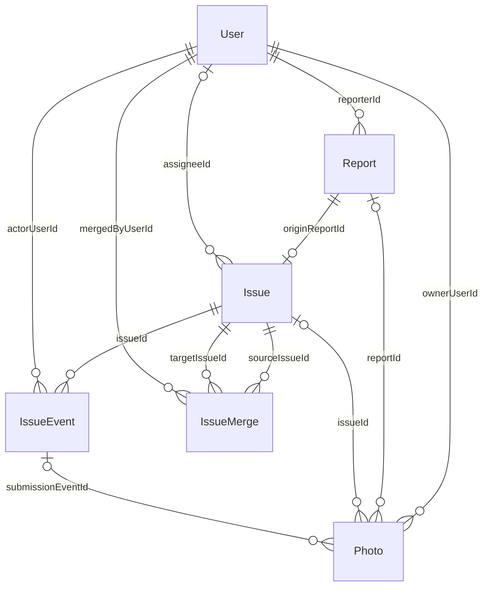
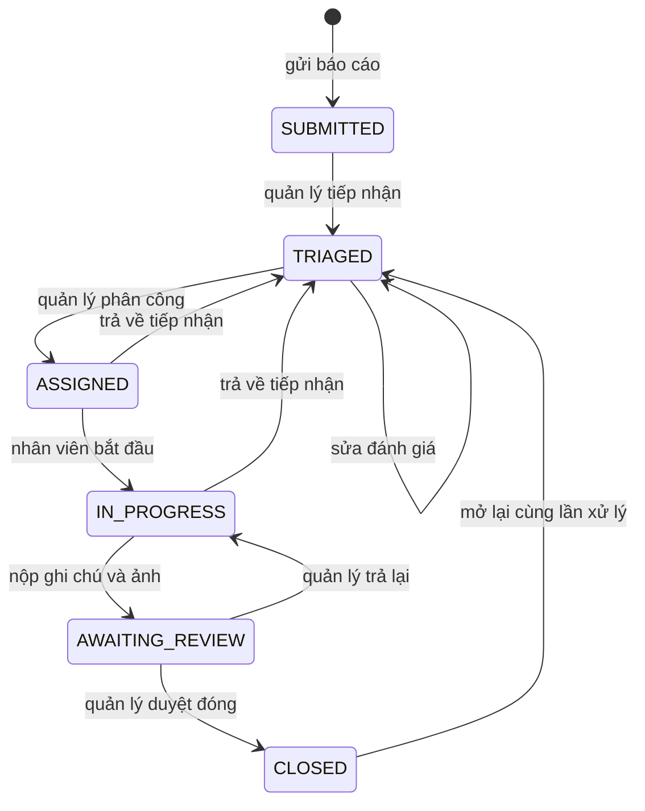

# CP2 - ERD Report/Issue, ảnh và trạng thái

Ngày 26/11/2026. Bổ sung cho bản ERD v1, giữ nguyên Report gốc. Các endpoint và quy tắc đầy đủ ở [hợp đồng CP2](Checkpoint2_Backend_Contract.md).

Một lần gửi tạo Report và Issue gốc trong cùng transaction. Report.issue là quan hệ tùy chọn ở schema để thực hiện quá trình tạo; API hoàn tất thì luôn có Issue. IssueMerge nối các Issue, không đổi Report.issue hoặc Issue.originReportId. Nhiều nguồn A/C gộp vào B là hai bản ghi A→B và C→B; B đọc Report A/C bằng truy vấn, không chuyển quyền sở hữu hay ghi đè mô tả.

Photo REPORT có reportId sau khi gửi; trước đó là ảnh nháp của owner. Photo WORK_EVIDENCE có issueId, submissionEventId sau submit. Tệp lưu riêng, metadata/quan hệ trong DB. Một Report hoặc một lượt nộp có tối đa 3 ảnh theo API. Khóa ngoại RESTRICT giúp giữ dữ liệu liên quan; API không cung cấp sửa/xóa ảnh đã nộp.

Gộp là quan hệ độc lập, không thêm trạng thái MERGED. CP2 chỉ gộp nguồn/đích SUBMITTED hoặc TRIAGED, chưa phân công và không reviewRequired. Source giữ trạng thái cũ nhưng bị ẩn/khóa công việc. Hủy gộp ghi reversedAt, giữ bản ghi và event, đặt source.reviewRequired=true. Chỉ review-after-unmerge xác nhận lại loại/ưu tiên/hạn mới đưa nguồn về TRIAGED và mở khóa phân công.

Hủy gộp vẫn được sau khi đích đã đóng: source không nhận closedAt, minh chứng hoặc người được giao của đích. Các bản ghi gốc không đổi; quyền đọc ảnh tính lại theo quan hệ đang hiệu lực. Sự cố tái phát sau khi đã xử lý là Issue mới có recurrenceOfIssueId, không tùy tiện mở lại một lần xử lý cũ.

Version không có cột riêng trong schema hiện tại: đếm IssueEvent. Mọi mutation của workflow/gộp ghi event và cập nhật/khóa Issue trong transaction; không xóa lịch sử. DB có CHECK source khác target, partial unique index một source chỉ có một merge chưa đảo; service ngăn chuỗi/vòng trong cùng giao dịch.
