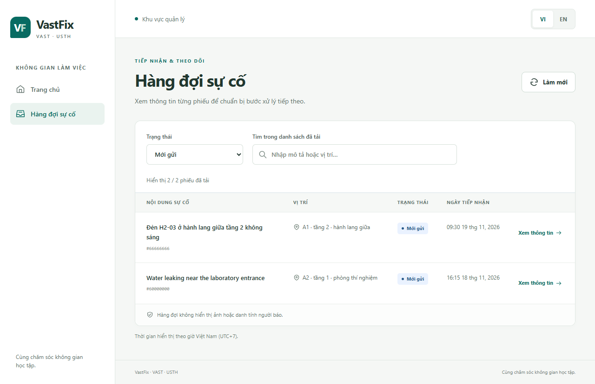
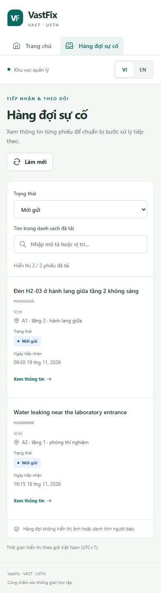

# Kết quả kiểm tra frontend của Sơn

Ngày chạy: 19/11/2026. Nhánh `codex/son-manager-frontend`, dựa trên foundation `e8afebf0b14bb4a871adcf15541a8acfba6debb7`. Chạy local trên Windows với Node 24.22.1, Next.js 16.4.6 và Chrome headless.

| Kiểm tra | Kết quả thực tế |
| --- | --- |
| Cài dependency bằng lockfile với Node 24 | Đạt; thêm next-intl 4.15.1 và @playwright/test 1.65.1 |
| Docker Compose PostgreSQL | Container healthy, local 127.0.0.1:5433 |
| `db:validate`, `db:generate` | Đạt |
| `db:deploy` | Áp dụng migration foundation có sẵn trên volume local mới |
| `db:seed`, `db:verify` | Đạt: 3 user fixture, 2 Report, 2 Issue SUBMITTED, 2 nhật ký tạo |
| `npm run typecheck` | Đạt; bản build cuối cũng hoàn thành bước TypeScript |
| `npm run build` | Đạt, build production với localized root layout |
| `npm run test:ui` | **13/13 đạt** ở lượt xác nhận cuối |
| `/api/health` trên dev server | HTTP 200, `status=ok`, `database=ok` |
| `/dev/database` trên dev server | HTTP 200, đọc được 8 bảng |
| `/vi/manager/issues` trên dev server | HTTP 200 |
| `/dev/database` trên production | HTTP 404, đúng giới hạn của foundation |
| `git diff --check` | Đạt |
| API contract/schema/migration/seed | Không sửa |

Các test UI thành công gồm response đúng contract; vi/en và html lang; giữ nguyên mô tả Việt/Anh; tìm không dấu; thông báo danh sách chưa đầy đủ; trạng thái empty, 401, 403, 500; retry sau network failure; response sai cấu trúc; loại response cũ khi đổi status; mobile 390px không tràn ngang; dialog dùng bàn phím/Escape và trả focus; nội dung người báo không được thực thi như HTML; giữ API health ngoài locale; không có demo fallback khi backend chưa tồn tại.

## Ảnh đã kiểm tra trực quan

Hai ảnh bên dưới dùng **response mô phỏng trong Playwright**, chỉ minh họa frontend khi backend trả dữ liệu hợp lệ. Chúng không chứng minh hàng đợi đã đọc DB hoặc tài khoản đã được xác thực.

## Phần chưa thể xác nhận

- Foundation chưa có API quản lý, API tạo Report hoặc runtime authentication. Request thật tới `/api/manager/issues?status=SUBMITTED` hiện trả 404 và UI hiển thị trạng thái không tải được.
- Chưa kiểm thử end-to-end người báo tạo dữ liệu thật rồi quản lý nhìn thấy, hoặc phân quyền thật giữa ba vai. Các test 401/403 ở đây chỉ xác minh cách frontend xử lý response.
- Chưa có giao tiếp phân trang request được chốt; UI nhận biết `nextCursor` nhưng chưa tự phát minh query mới.
- Mới kiểm tra tự động trên Chrome desktop và kích thước mobile; chưa kiểm thử Safari/iOS thật.
- Gộp, hủy gộp, phân công, ảnh và chi tiết đầy đủ vẫn là bước sau theo phạm vi checkpoint. Luồng thiết kế nằm trong tài liệu bàn giao.

Không push trong phiên làm việc này. Xem [bàn giao frontend](Son_Frontend_Handoff.md) để chạy lại và ghép với phần của Chúc, Hải Anh, Dương.
